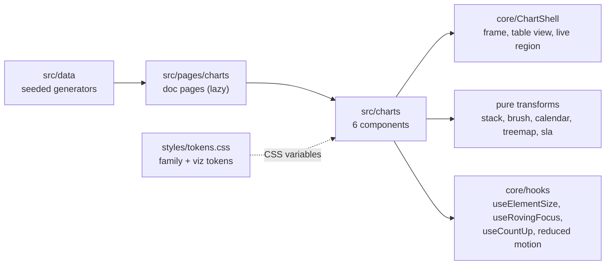

# Atlas

**Charts that read your infrastructure like a map.**

Atlas is a security visualization kit: six typed, accessible React chart components for backup and data-security consoles, plus a gallery that documents each one with a live demo, props table, usage snippet and keyboard map.

- Live: https://atlas-vishwajeet.vercel.app (placeholder)
- Code: https://github.com/Vishwazeer/atlas

## Features

| Component | Answers | Built on |
|---|---|---|
| `TopologyGraph` | Which machines sit behind a failing cluster? | d3-force, d3-zoom |
| `BrushTimeSeries` | When did throughput dip, and for how long? | d3-scale, d3-shape |
| `CalendarHeatmap` | Which days of the year had failed backups? | d3-scale threshold |
| `DataTreemap` | Where does sensitive data live? (region, system, class, drill-in) | d3-hierarchy |
| `SeverityBreakdown` | Are critical threats rising week over week? | d3-scale band |
| `SlaRings` | Which recovery objectives are we missing? | d3-shape arc |

Every chart shares one `ChartShell`:

- **Token-themed**: marks paint with CSS variables (`--viz-seq-*`, `--viz-sev-*`, `--viz-cat-*`); flipping `data-theme` recolours every chart with no re-render. Palettes were checked for lightness, CVD separation and contrast in both themes.
- **Keyboard**: one mark in the tab order, arrow keys rove the rest in the chart's own geometry (grid for the calendar, week x severity for stacks), every move announced in a polite live region.
- **"View as table"**: a switch swaps the picture for a real `<table>` with caption and headers.
- **Responsive**: ResizeObserver measures before paint, so there is no layout shift.
- **Reduced motion**: SLA arcs, count-ups, page fades and skeleton shimmer all stand still.
- Lazy-loaded chart pages (`React.lazy` + `Suspense`) with skeleton states, SVG favicon, OG image.

## Tech stack

React 19, TypeScript (strict, `noUncheckedIndexedAccess`), Vite, d3 modules (force, zoom, hierarchy, scale, shape, contour), Vitest + React Testing Library, Playwright, ESLint, GitHub Actions, Vercel.

## Architecture



Transforms are pure functions, unit-tested apart from React. Components never hold colours, only token names.

## Scripts

```bash
npm install
npm run dev        # gallery at http://localhost:5173
npm test           # Vitest + RTL
npm run typecheck  # tsc (app + node configs)
npm run lint
npm run build
npm run e2e        # Playwright (PW_CHANNEL=chrome reuses an installed Chrome)
node scripts/og-image.mjs   # regenerate public/og.png
```

Deploys on Vercel with zero config (Vite preset); `vercel.json` only adds the SPA rewrite for `/charts/*` deep links.

## How I used AI

AI (Claude) drafted the component scaffolding, the seeded data generators, the test suites and these docs. I set the design constraints (one axis, ordinal severity ramp, status never colour-only, wheel zoom only with Ctrl), ran the palettes through a colour validator, reviewed every chart in both themes and at phone width, and fixed what the review found (a wheel-zoom scroll trap, a muddy severity ramp, a focus race after treemap drill-in). See [AI_WORKFLOW.md](AI_WORKFLOW.md).

## Numbers

| Measure | Value |
|---|---|
| Unit + component tests | 40 (Vitest) |
| E2E tests | 26 (13 specs x desktop + mobile) |
| JS gzip, first load (react + d3 + app) | ~130 kB [measure on deploy] |
| Lighthouse performance / accessibility | [measure] |
| Largest DOM chart (calendar) | 365 focusable cells |
| Topology layout settle time | [measure] |
